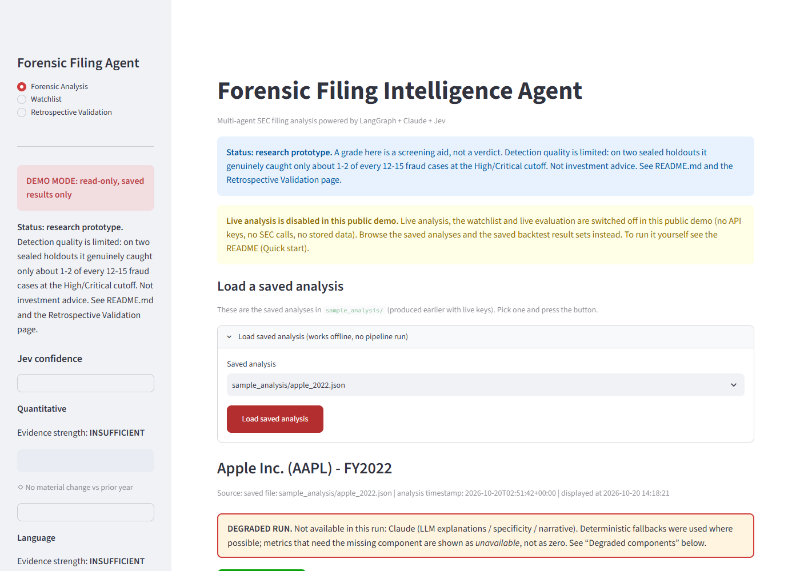
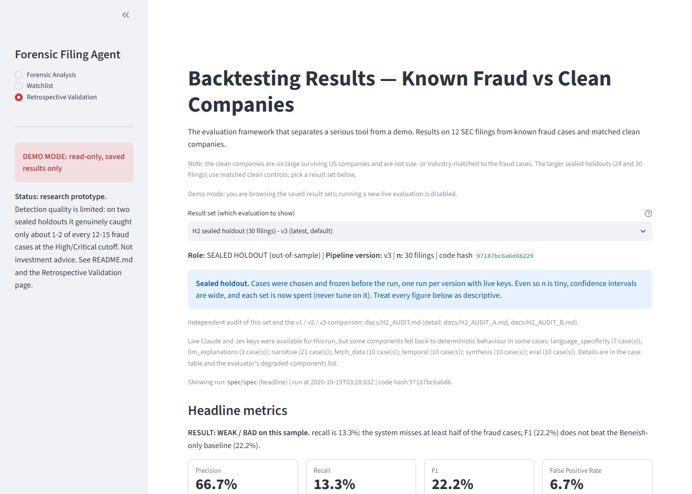
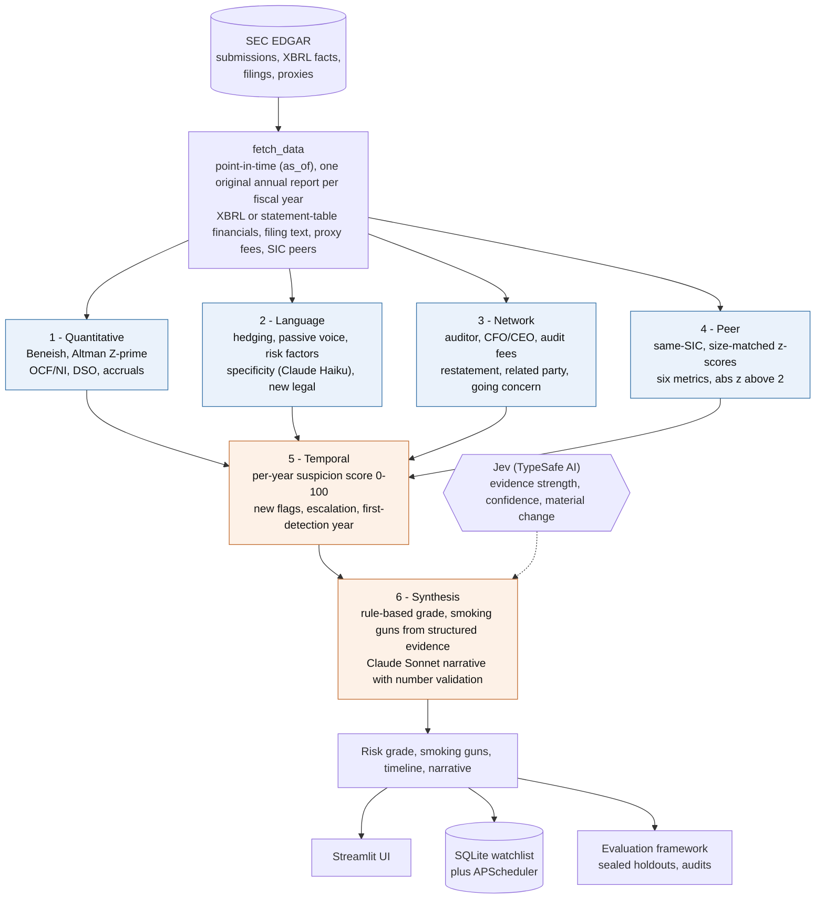
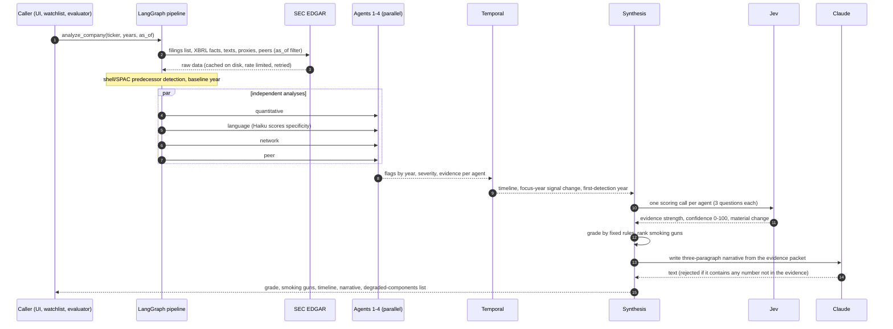
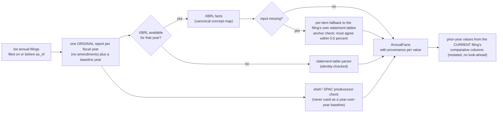
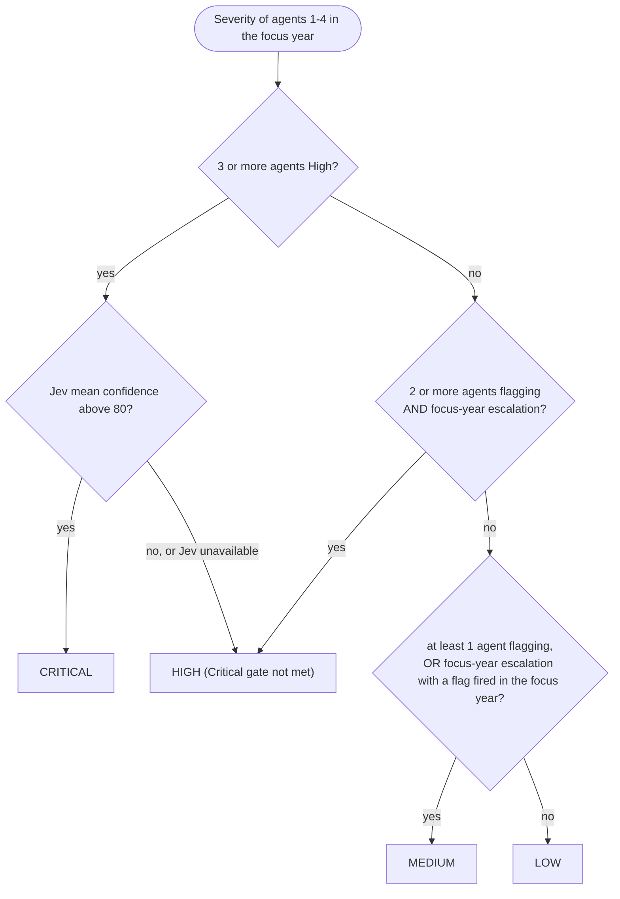
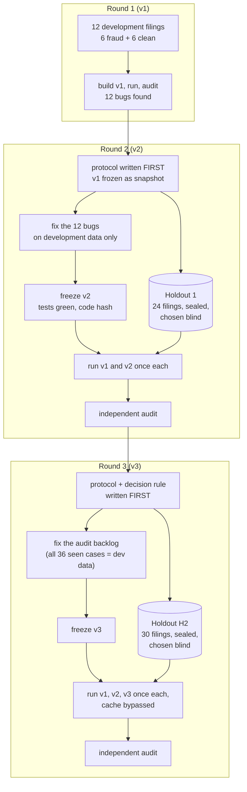
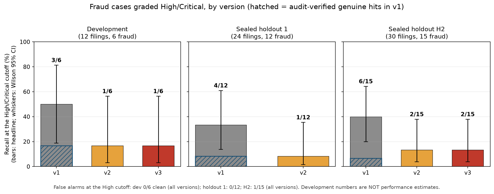
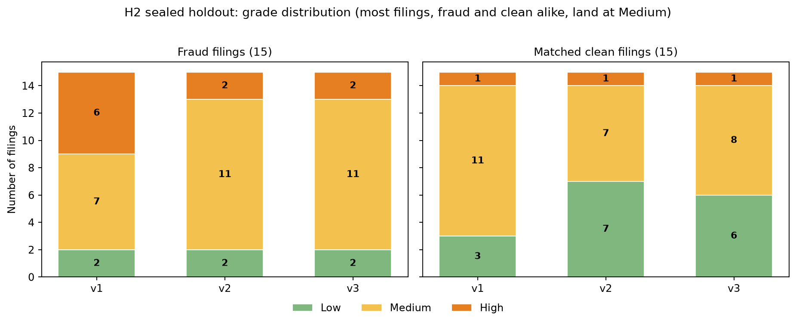
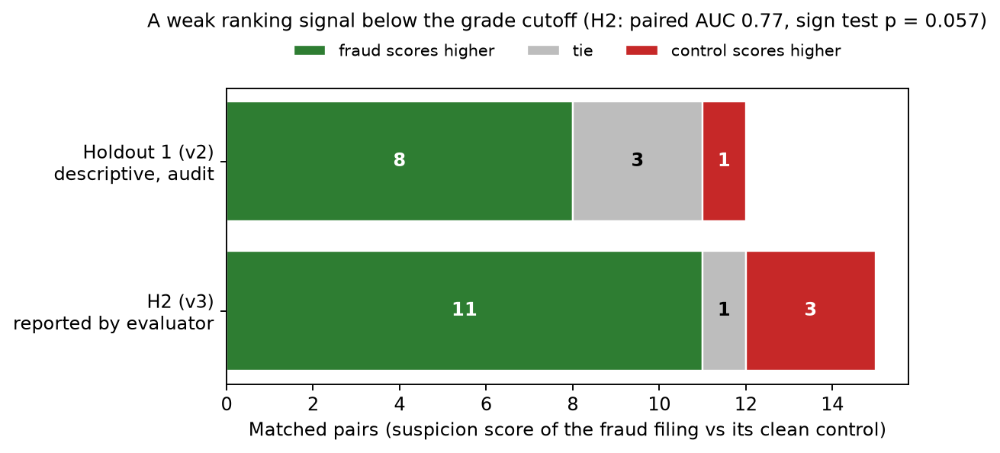

# forensic-filing-agent

**A six-agent system that screens SEC filings for accounting-manipulation risk, and a rigorous, pre-registered way of finding out whether it actually works.**


-6f42c1)

-lightgrey)


> **The honest headline.** As a High/Critical-grade classifier this system does **not** detect accounting fraud reliably. Across three evaluation
> sets (12 development filings, a sealed 24-filing holdout, a second sealed 30-filing holdout; each version run once per sealed set, each result
> independently audited), genuine detections are roughly **1–2 per 12–15 fraud cases**, while false alarms at the High cutoff are rare (0/12 and 1/15).
> Two rounds of fixes (v2, v3) did not improve recall, and the pre-registered "v3 improves" rule **failed**. What exists is a weak, cutoff-free ranking
> signal (fraud outscores its matched control in 11 of 15 pairs, AUC ≈ 0.77) inside a methodology that is the real contribution of this repo.
> Not investment advice.

---

## Contents
1. [What it is and why](#1-what-it-is-and-why)
2. [See it](#2-see-it)
3. [Architecture](#3-architecture)
4. [How one filing becomes a grade](#4-how-one-filing-becomes-a-grade)
5. [The data layer: point-in-time, no look-ahead](#5-the-data-layer-point-in-time-no-look-ahead)
6. [The six agents and their signals](#6-the-six-agents-and-their-signals)
7. [Scoring: suspicion score, severity and the grade](#7-scoring-suspicion-score-severity-and-the-grade)
8. [How it was evaluated](#8-how-it-was-evaluated-the-part-that-matters-most)
9. [Results](#9-results)
10. [What the audits found](#10-what-the-audits-found)
11. [Limitations](#11-limitations-please-read)
12. [Quick start](#12-quick-start)
13. [Configuration](#13-configuration)
14. [Deploying a public demo](#14-deploying-a-public-demo)
15. [Repository map and documentation index](#15-repository-map-and-documentation-index)
16. [Roadmap](#16-roadmap-what-would-actually-improve-it)
17. [Deviations from the original spec, data sources, references](#17-deviations-from-the-original-spec-data-sources-references)

---

## 1. What it is and why

Accounting fraud and aggressive earnings management leave traces in public filings: receivables that grow faster than sales, accruals that outrun cash flow,
a new auditor and a new CFO in the same year, language that gets vaguer, related-party disclosures that balloon. Each trace alone is weak and noisy.
This project asks three questions:

| Question | Design answer |
|---|---|
| Can independent views of the *same* filing agree on risk? | **Multi-signal independence**: four specialist agents (quantitative, language, network, peer) analyse the same filing from unrelated angles and never see each other's output. |
| Does *change over time* say more than a snapshot? | **Temporal intelligence**: a fifth agent tracks which flags are new each year, scores each year 0–100 and finds the first year the system would have flagged the company. |
| Does any of it actually work? | **Retrospective validation**: point-in-time data access, sealed holdouts, pre-registered rules, exact confidence intervals and independent audits of *why* each grade came out as it did. |

The tool analyses a company's annual reports (10-K, 10-K405, 20-F) for the last several fiscal years and returns a risk grade
(Low / Medium / High / Critical), the three most specific findings ("smoking guns"), a per-year timeline and a three-paragraph narrative.
**It was built as a screening aid and a research artifact, not a verdict.**

---

## 2. See it

The Streamlit app has three pages: forensic analysis of one company, a filing watchlist, and the retrospective-validation results. The screenshots
are from the read-only public-demo mode (see [section 14](#14-deploying-a-public-demo)).

| Forensic analysis (saved sample loaded) | Backtest results with a result-set selector |
|---|---|
|  |  |

A sample output for Enron's FY2000 10-K (filed 2001-04-02, 6.5 months before the October 2001 revelation) is in
[`sample_analysis/enron_2000.json`](sample_analysis/enron_2000.json): grade **High**; Beneish M-score −0.66 (manipulator zone; receivables +243% against revenue
+151%); a new legal proceeding; the CEO change from Lay to Skilling; related-party disclosures +130%.

---

## 3. Architecture



The four first-stage agents run **in parallel** as a LangGraph fan-out and **share no information**; the temporal agent is the fan-in; synthesis runs last.
Any agent can fail or be unavailable (no peer group for a pre-2009 filing, no cost-of-goods line, no API key) and the run continues with that gap *stated*,
never filled with a made-up number. Missing API keys are a normal state: every LLM or Jev step has a deterministic fallback and every run lists what fell back.

---

## 4. How one filing becomes a grade



---

## 5. The data layer: point-in-time, no look-ahead

Backtests on financial data are easy to get wrong. The most common error is **look-ahead bias**: using a number that was only restated later, or a filing
that did not yet exist. Every data access in this project takes an `as_of` date and nothing filed after it is used.



Key properties: every number carries its **source** (XBRL tag, or statement row label); items that cannot be found are reported `unavailable` with the missing
concept named (never zero, never invented); the only imputations are documented and flagged (SGAI and DEPI neutral at 1.0 as the Beneish literature allows,
LongTermDebt = 0 only with balance-sheet evidence); Altman uses the book-equity Z′ variant because market cap is not on EDGAR; pre-2009 filings (Enron,
WorldCom) have no XBRL, so their statements are parsed from the filing's own tables and validated by accounting identities.

---

## 6. The six agents and their signals

| # | Agent | Flags (fixed vocabulary) | Thresholds | Notes |
|---|---|---|---|---|
| 1 | **Quantitative** | `beneish` · `altman_distress` · `revenue_quality` · `dso_growth` · `accruals` | M > −1.78 (8-variable model) · Z′ < 1.23 · OCF/NI < 0.8 two years running · DSO +20% YoY · accruals > 5% of assets | TATA = (NI − OCF)/TA (the spec's sign would invert the signal). Altman distress is labelled a *business-distress* signal, not manipulation. Revenue below 1% of assets makes revenue-based ratios *not meaningful*. |
| 2 | **Language** | `hedging` · `passive_voice` · `risk_factor_growth` · `specificity` · `new_legal` | hedging ratio +25% YoY · passive share +25% YoY · risk-factor length +40% YoY · specificity < 5 or −2 points (Claude Haiku) · new matter by identifier | Parsed from MD&A / Risk Factors / Legal Proceedings (20-F item equivalents supported). `new_legal` compares captions, docket numbers, agencies and courts, not raw wording. No key means specificity is *unavailable*, never a stand-in score. |
| 3 | **Network** | `auditor_change` · `cfo_change` · `ceo_change` · `audit_fees` · `restatement` · `related_party` · `going_concern` | fees +30% without revenue growth · related-party text +50% and ≥ 3,000 chars | Negation- and boilerplate-aware (accounting-standard text, SOX certifications, investee restatements, remediated history and risk-factor hypotheticals are excluded). Merger/SPAC-driven changes are recorded but do not count as flags. |
| 4 | **Peer** | `peer.<metric>` for gross margin, DSO, receivables-vs-revenue growth, OCF/revenue, debt/equity, ROA | \|z\| > 2.0 against ≥ 3 same-SIC, size-matched peers | Two-sided display, but only manipulation-consistent directions count toward severity (a-priori table with citations in the module). Peers use only data filed by `as_of`. |
| 5 | **Temporal** | derives `new_flags_this_year`, `signal_change` | first detection = score ≥ 40 **and** escalating | Shell/stub years excluded; peer flags cannot by themselves create "escalating". |
| 6 | **Synthesis** | the grade | see below | Grade by fixed rules; Claude Sonnet writes the narrative only. |

---

## 7. Scoring: suspicion score, severity and the grade

**Per-year suspicion score (0–100, temporal agent).** Each fired flag adds 10; some add a bonus on top.

| Flag | Total points | | Flag | Total points |
|---|---|---|---|---|
| Beneish in manipulator zone | 30 | | CFO change | 20 |
| Going concern | 35 | | CEO change | 0 (recorded only) |
| Altman distress | 25 | | any other flag | 10 |
| Auditor change | 25 | | cap | 100 |

Risk bands: **Low** 0–29 · **Medium** 30–59 · **High** 60–79 · **Critical** ≥ 80.

**Agent severity** (focus year only): High = a hard flag (Beneish, going concern, reported restatement or material weakness, auditor + CFO change together outside a merger,
or ≥ 3 peer outliers) or ≥ 3 flags; Medium = 2 flags; Low = 1; None = 0. An agent is "flagging" at Medium or High.

**The grade** is computed by a pure, separately tested function:



Jev confidence is reported and gates *Critical*, but in practice it never exceeded 80, so Critical never fired. The structural weakness this exposed is covered
in [section 10](#10-what-the-audits-found): "High needs two agents" cannot reward a single strong, on-mechanism signal.

**Smoking guns** are chosen from the agents' structured evidence (hard flags first, then focus year, then magnitude) and phrased deterministically. Claude Sonnet
may write the narrative, but its text is rejected if it contains **any number that is not in the evidence packet** (it then falls back to a deterministic narrative).

---

## 8. How it was evaluated (the part that matters most)

The risk in a project like this is fooling yourself. Three rounds of building, each with stricter controls:



Controls that make the numbers trustworthy:

* **Point-in-time everywhere.** Nothing filed after the analysed filing's date is used (see section 5). Case labels carry the first public revelation date, and cases whose filing post-dates it are flagged and handled in a separate "strict" run.
* **Sealed holdouts.** Selected by a separate agent from enforcement records, never run through the system before the freeze, and the orchestrator stayed blind to their contents until then. Each has a matched clean control (same fiscal year, same SIC where possible, assets 0.3x–3x, no restatement or enforcement in the following years).
* **Pre-registered rules.** Protocol and decision rule written before any run ([`docs/V2_PROTOCOL.md`](docs/V2_PROTOCOL.md), [`docs/V3_PROTOCOL.md`](docs/V3_PROTOCOL.md)). "v3 improves" was defined as: recall beats v2's with paired exact p < 0.10 and no worse false positives.
* **Freeze + hash.** Each version's code hash and full-suite result are recorded before the holdout run ([`docs/V2_FREEZE.md`](docs/V2_FREEZE.md), [`docs/V3_FREEZE.md`](docs/V3_FREEZE.md)); each version runs exactly once, with the results cache bypassed.
* **Honest statistics.** Exact Wilson 95% intervals, exact McNemar and sign tests, baselines (Beneish alone, "always predict clean"), a cutoff-free paired score comparison.
* **Independent audits.** Read-only agents re-read the filings behind every decisive flag and classify it genuine / mechanical artifact / boilerplate false positive / data gap ([`docs/EVAL_AUDIT.md`](docs/EVAL_AUDIT.md), [`docs/HOLDOUT_AUDIT.md`](docs/HOLDOUT_AUDIT.md), [`docs/H2_AUDIT.md`](docs/H2_AUDIT.md)).
* **A contamination ledger.** Every change motivated by an evaluation case is logged ([`docs/TUNING_LEDGER.md`](docs/TUNING_LEDGER.md)); no spec threshold was tuned on evaluation data.
* **Incidents are disclosed, not hidden.** One run was invalidated because a test double poisoned the results cache; the invalid output is kept, labelled, and the cache is now hardened against it ([`docs/V2_FREEZE.md`](docs/V2_FREEZE.md)).

---

## 9. Results

Positive prediction = grade **High** or **Critical**. Intervals are exact Wilson 95%.



| Evaluation set | Role | Version | TP / FP / TN / FN | Recall (95% CI) | False-positive rate (95% CI) |
|---|---|---|---|---|---|
| 12 development filings | development (not an estimate) | v1 | 3 / 0 / 6 / 3 | 50% (19–81%) | 0% (0–39%) |
| | | v2, v3 | 1 / 0 / 6 / 5 | 17% (3–56%) | 0% (0–39%) |
| Holdout 1: 24 filings | sealed | v1 | 4 / 0 / 12 / 8 | 33% (14–61%) | 0% (0–24%) |
| | | v2 | 1 / 0 / 12 / 11 | 8% (1.5–35%) | 0% (0–24%) |
| **H2: 30 filings** | sealed | v1 | 6 / 1 / 14 / 9 | 40% (20–64%) | 7% (1–30%) |
| | | v2 | 2 / 1 / 14 / 13 | 13% (4–38%) | 7% (1–30%) |
| | | v3 | 2 / 1 / 14 / 13 | 13% (4–38%) | 7% (1–30%) |

* **The pre-registered improvement rule failed.** v3 equals v2 on every fraud grade in H2 (2/15 vs 2/15). Beneish coverage on fraud cases rose from 7 to 9 of 15 but moved no grade.
* **The headline overstates v1.** The audits found that only about one of v1's High grades per set was a genuine detection (the hatched bars above). The rest rested on boilerplate, classification artifacts, or a passive-voice flag that fired on 29 of 30 filings.
* **The one clean-cut success** is Enron: the FY2000 10-K graded High, 6.5 months before the revelation (2001-10-16) and 8.0 months before the bankruptcy, from a Beneish M-score of −0.66 plus corroborating network and language signals. It is one case.
* **Statistical power is limited.** With 15 fraud cases a 4-case difference cannot reach p < 0.10 (smallest exact p = 0.125). "v2 = v3" means no *detectable* effect, not that the changes are useless.



Most filings, fraud and clean alike, land at **Medium**. The grade cutoff is where information is lost, not the ranking:



Fraud filings outscore their matched clean control in 11 of 15 H2 pairs (3 losses, all artifact-driven; about 5 of the 11 wins are genuine). That is a weak but non-trivial **ranking** signal (paired AUC 0.77, 95% bootstrap CI 0.57–0.93, sign test p = 0.057). The charts are regenerated from the stored result files by [`scripts/make_readme_figures.py`](scripts/make_readme_figures.py).

---

## 10. What the audits found

1. **A flag that fires on everything is worse than no flag.** The original passive-voice rule (> 15% of sentences) fired on 25/25 healthy filings and on 29/30 H2 filings. It silently lifted borderline cases to Medium and then High, which inflated v1's recall. Removing it (v2) removed the inflation *and* one genuine detection.
2. **Boilerplate masquerades as signal.** Accounting-standard text ("ASU 2014-15 requires management to evaluate…"), SOX certification language, hypothetical risk-factor sentences and investee restatements all matched the keyword detectors. Each guard added in v2/v3 removed real false positives, and one still slips through (the single H2 false positive is exactly this).
3. **SPAC mergers create fake "management changes".** A "prior-year annual report" that is a SPAC shell makes the auditor, CFO and CEO appear to change, and creates fake legal and going-concern flags. v2 detects shell and predecessor filings and never uses them as baselines.
4. **Data coverage, not rules, is the largest gap.** Beneish was computable in the focus year for only 9 of 15 H2 fraud cases (expense-by-nature statements, unusual row labels, IPO-year balance sheets).
5. **The "two agents" grade rule is the structural bottleneck.** 12 of the 13 missed H2 fraud cases had at most one agent at Medium or above, so a strong on-mechanism signal (e.g. a clear Beneish flag) stays at Medium.
6. **Some "improvements" were corrections.** The development-set drop from v1 to v2 *looked* like a loss for the system; the audit shows it was removal of inflation. This is exactly what holdouts and audits are for.

---

## 11. Limitations (please read)

* **Detection quality is limited.** Genuine recall is about 1–2 per 12–15 fraud cases on every set; confidence intervals are wide; the three evaluation sets are small, selected from enforcement records, and now spent for tuning purposes.
* **Selection and survivorship bias.** Fraud cases are those that were caught and documented; undetected frauds and small-cap false alarms are absent. Clean controls mean "no known problem", not "proven clean".
* **What it cannot see.** Frauds that keep ratios plausible (WorldCom's capitalised costs did not move Beneish), internally consistent fabricated revenue (Luckin shows nothing in XBRL ratios), off-balance-sheet structures, anything outside public filings. It has no price or market data. Amendments (10-K/A) are excluded.
* **Coverage gaps.** No peer group for pre-2009 filings or non-USD reporters; Beneish unavailable for filers without cost-of-goods or SG&A lines; the statement parser does not handle 20-F tables.
* **Known remaining defects (v4 backlog):** going-concern boilerplate that evades the pronouncement guard, receivables measured as current-only in a reclassification year, escalation triggered by oscillating flags, and the live Claude Sonnet narrative being rejected by the paragraph-count validator (the deterministic narrative is used instead; grades, evidence and Jev scores are unaffected).
* **Live LLM/Jev behaviour is lightly tested** (one inspected run per tier plus the evaluation runs). Jev's confidence never exceeded 80.
* **Platform coverage.** Clean installs verified on Python 3.14 and 3.11 on Windows; Linux, macOS and Python 3.10 were not run; the Streamlit Cloud deployment was not tested on the platform itself.
* **Not investment advice.** Past detection performance does not guarantee future accuracy. This is a research tool.

---

## 12. Quick start

```bash
git clone <this repository> && cd forensic-filing-agent
python -m venv .venv && source .venv/bin/activate          # Windows: .venv\Scripts\activate
pip install -r requirements.txt && python -m spacy download en_core_web_sm
cp .env.example .env     # then edit .env (see Configuration); secrets go ONLY in .env
streamlit run app.py
```

* **Analyse a company** from the UI (ticker + years) or in code:
  ```python
  from graph.pipeline import analyze_company_sync
  state = analyze_company_sync("AAPL", years=5)            # latest filings
  state = analyze_company_sync("ENRNQ", years=5, cik="0001024401",
                               as_of="2001-04-02", end_year=2000)   # point-in-time, delisted ticker
  print(state["risk_grade"], state["smoking_guns"])
  ```
* **Watchlist:** `python watchlist_monitor.py --add AAPL:Medium --once` (SQLite + APScheduler; alerts when a grade worsens past your threshold).
* **Re-run the evaluation** on the 12 development cases: `python -m evaluation.evaluator --mode both --variants spec` (about 20 minutes with a warm EDGAR cache). How each version was run on a sealed holdout: `python scripts/run_holdout.py --help`.
* **Tests:** `python -m pytest -q` (991 with network and keys; `-m "not network"` runs 904 offline). **Regenerate samples:** `python scripts/generate_samples.py`.
* Without API keys everything runs in a clearly labelled **degraded mode**. Step-by-step install for Windows and Linux/macOS, and common errors (TLS-inspecting proxy, missing spaCy model, SEC 403): [`docs/INSTALL.md`](docs/INSTALL.md).

## 13. Configuration

| Variable (in `.env`) | Needed for | Notes |
|---|---|---|
| `SEC_USER_AGENT` | any SEC access | **Required by SEC policy**: `AppName your-real@email`. Without a real value the app defaults to read-only demo mode. |
| `ANTHROPIC_API_KEY` | specificity score, explanations, narrative | Optional; deterministic fallbacks otherwise. |
| `JEV_API_KEY` | per-agent confidence scoring | Optional; Critical is unreachable without it. |
| `WATCHLIST_CHECK_INTERVAL_HOURS` | scheduler | Default 24. |
| `WATCHLIST_DB_PATH`, `EDGAR_CACHE_DIR` | storage locations | Defaults `watchlist/watchlist.db`, `.cache/`. |
| `FFA_DEMO_MODE`, `FFA_ACCESS_CODE` | public deployments | See below. |

---

## 14. Deploying a public demo

A **read-only demo** (saved sample analyses and saved backtest results; no SEC, Claude or Jev calls, no database) is the recommended public deployment. It uses a
four-package requirements file, so it installs quickly and needs no secrets.

* Streamlit Community Cloud: main file path **`deploy/streamlit_demo.py`**, Python **3.11**, no secrets. Full steps, the optional gated live mode, and what was *not* verified on the platform: [`docs/DEPLOY.md`](docs/DEPLOY.md).
* Locally: `pip install -r deploy/requirements.txt && streamlit run deploy/streamlit_demo.py`.
* **Do not put live API keys on a public URL**: anyone could spend your Anthropic and Jev credits and hit SEC under your name.

---

## 15. Repository map and documentation index

```
forensic-filing-agent/
├── app.py                      Streamlit UI (analysis, watchlist, backtest result sets, demo mode)
├── app_components/             charts, formatting, evaluation adapter, demo-mode helpers
├── agents/                     quantitative, language, network, peer, temporal, synthesis + shared state
├── tools/                      EDGAR client, XBRL + statement parsers, text parser, metrics, peers, Jev scorer, LLM client
├── graph/pipeline.py           LangGraph assembly (parallel fan-out, fan-in, synthesis)
├── evaluation/                 cases, evaluator, sealed holdouts, results (every run kept)
├── watchlist/, watchlist_monitor.py   SQLite watchlist, APScheduler monitor, CLI
├── prompts/                    all system prompts and the reviewed pattern table
├── deploy/                     Streamlit Cloud demo entrypoint + minimal requirements
├── scripts/                    sample generation, holdout runner, figure generation
├── sample_analysis/            saved v3 analyses (Enron 2000, Luckin 2019, Apple 2022)
├── tests/                      991 tests
└── docs/                       specs, protocols, freezes, audits, changelogs, install and deploy guides, figures
```

| Read this | To learn |
|---|---|
| [`docs/H2_AUDIT.md`](docs/H2_AUDIT.md), [`docs/HOLDOUT_AUDIT.md`](docs/HOLDOUT_AUDIT.md), [`docs/EVAL_AUDIT.md`](docs/EVAL_AUDIT.md) | why each grade came out as it did (plus the `_A` / `_B` detail files) |
| [`docs/V2_PROTOCOL.md`](docs/V2_PROTOCOL.md), [`docs/V3_PROTOCOL.md`](docs/V3_PROTOCOL.md) | the pre-registered evaluation protocols and decision rule |
| [`docs/V2_FREEZE.md`](docs/V2_FREEZE.md), [`docs/V3_FREEZE.md`](docs/V3_FREEZE.md) | code hashes, test results, the invalid-run incident |
| [`docs/TUNING_LEDGER.md`](docs/TUNING_LEDGER.md) | every change motivated by evaluation data, and known data artifacts |
| `docs/V2_CHANGELOG_*.md`, `docs/V3_CHANGELOG_*.md` | what changed and why, per area |
| [`docs/case_research.md`](docs/case_research.md), [`docs/holdout_research.md`](docs/holdout_research.md), [`docs/holdout2_research.md`](docs/holdout2_research.md) | how every evaluation case was selected and verified (with sources) |
| [`docs/CONTRACTS.md`](docs/CONTRACTS.md), [`docs/SPEC.md`](docs/SPEC.md) | the module interfaces and the original specification |
| [`docs/INSTALL.md`](docs/INSTALL.md), [`docs/DEPLOY.md`](docs/DEPLOY.md) | setup and deployment |

---

## 16. Roadmap: what would actually improve it

The audits point to a short list, in order of expected payoff. Each must be validated on a **new, unseen** evaluation set, because all three existing sets are spent.

1. **A much larger labeled dataset** (100+ fraud cases from the SEC AAER index, with matched controls) so that improvements are *measurable*; cross-validate by company and period, keep a final sealed test.
2. **Close the Beneish coverage gaps** (expense-by-nature statements, unusual row labels, IPO-year prior balance sheets).
3. **Replace hand-set flag weights and the two-agent grade rule with a calibrated, fitted model** that lets one strong on-mechanism signal count (compare the earnings-quality literature below).
4. **Remaining false positives:** verbatim ASU 2014-15 wording, persistence requirements for "escalation", total-receivables DSO base, accounting-standard adoption years.
5. **Re-scope the claim** from "classifier" to "triage ranker": report AUC and precision at the top-k, and state plainly which frauds are ratio-visible and which are not.

---

## 17. Deviations from the original spec, data sources, references

**Deliberate deviations** (all documented in [`docs/CONTRACTS.md`](docs/CONTRACTS.md)): Beneish TATA uses (NI − OCF)/TA, not the spec's inverted sign; Altman uses the book-equity Z′ variant because
market cap is not on EDGAR; the Jev package is `typesafe-sdk` (`typesafe-ai` on PyPI is a redirect shim); three spec CIKs were wrong (Luckin 1767582, Lordstown 1759546, Virgin Galactic 1706946);
the spec's passive-voice cut-off (> 15%) was replaced in v2 by a year-over-year-increase rule; the grade rule's "temporal escalation" is the focus-year signal only; the spec named six sample files but listed three, so three are provided.

**Data sources** (all free and public): SEC EDGAR submissions, XBRL `companyfacts` and `frames` APIs; filing documents (10-K, 10-K405, 20-F); DEF 14A proxy statements; EDGAR SIC listings for peers; the SEC AAER and litigation-release pages and press coverage for evaluation labels.

**Further reading** (verify details before citing): Beneish (1999), "The Detection of Earnings Manipulation", *Financial Analysts Journal*; Altman (1968), "Financial Ratios, Discriminant Analysis and the Prediction of Corporate Bankruptcy", *Journal of Finance*;
Dechow, Ge, Larson & Sloan (2011), "Predicting Material Accounting Misstatements", *Contemporary Accounting Research*; Bao, Ke, Li, Yu & Zhang (2020), "Detecting Accounting Fraud in Publicly Traded U.S. Firms Using a Machine Learning Approach", *Journal of Accounting Research*.

**License:** not yet specified (add one before publishing). **Disclaimer:** This evaluation uses publicly available SEC filings. Past detection performance does not guarantee future accuracy. This tool is for research purposes and does not constitute investment advice.
